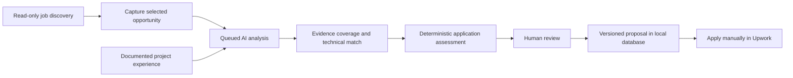
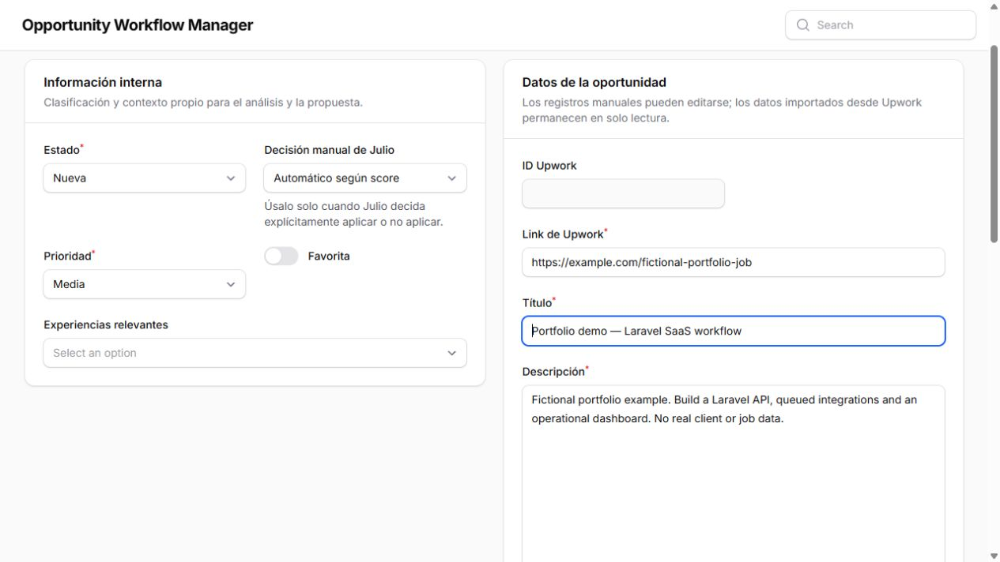
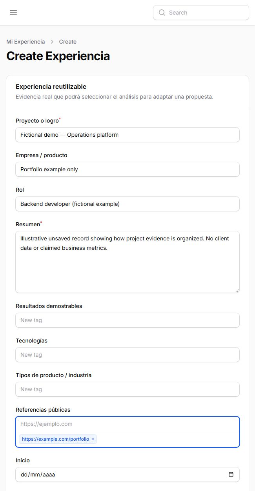
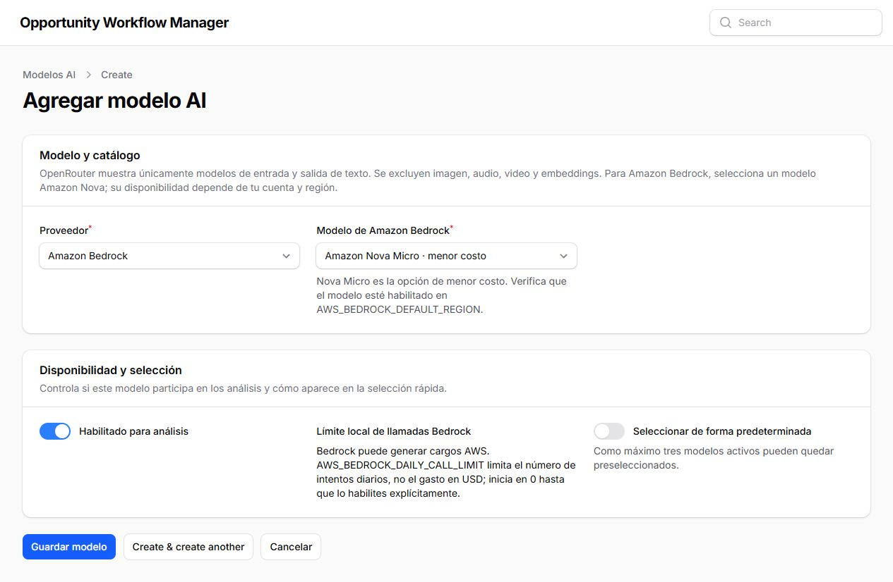
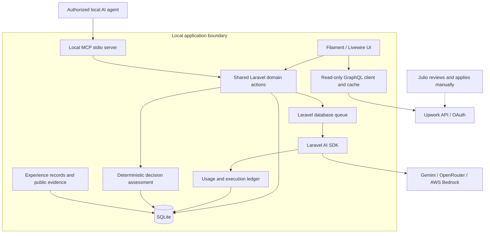

# Opportunity Workflow Manager

### Evidence-backed opportunity review. Human-controlled decisions.

A local-first Laravel application built by **Julio Solis** to connect job discovery, documented professional experience, AI-assisted analysis, and versioned proposals in one auditable workflow.

**Laravel 13 · Filament 5 · Livewire 4 · SQLite · Laravel AI SDK · MCP**

This is a **public portfolio showcase**, not the application source or a hosted service. The implementation and operational data remain private. The application interface is currently in Spanish; this presentation is in English.

## The problem

A job can contain familiar technologies and still be a poor opportunity: missing evidence for a critical requirement, high competition, unclear scope, an unsuitable budget, or expensive application credits. Keyword overlap alone should not become a recommendation to apply.

The application separates three questions:

1. **Technical fit:** what requirements match documented project experience?
2. **Evidence coverage:** what is demonstrated, transferable, or not yet documented?
3. **Application convenience:** is this opportunity worth spending Connects on?

Missing documentation is not treated as proof of missing experience. A confirmed gap requires an explicit human decision.

## Workflow

An authorized external agent can also capture an opportunity and persist structured analysis through the local MCP server. The application does **not** submit proposals, send messages, or modify Upwork.

## What I built

- **Read-only Upwork GraphQL integration:** OAuth, saved local search profiles, category/subcategory filters, bounded queries, and cached results.
- **Experience-aware discovery:** preliminary PHP matching against registered technologies, followed by structured AI evidence review. Preliminary affinity is explicitly not proof of experience.
- **Structured experience coverage:** demonstrated and partial matches reference actual experience records, roles, public links, and registered outcomes. Unverified requirements remain visible for human review.
- **AI orchestration:** queued analysis with Gemini, OpenRouter, and Amazon Bedrock through Laravel AI SDK; selectable models for manual comparisons and input-aware duplicate prevention.
- **Usage and failure visibility:** model/provider attribution, input/output, execution status, duration, reported tokens, and available cost. Unknown cost stays unknown. Local quotas include failed attempts.
- **Proposal traceability:** immutable versions, reusable historical drafts, and many-to-many opportunity links with individual submission tracking and events.
- **Operational UI:** Filament resources, analysis-completeness filters, evidence summaries, execution logs, queued/failed jobs, and daily Laravel logs.
- **Local MCP server:** validated tools for opportunity capture, analysis, search, deferral, proposal versions, and traceability. No arbitrary SQL or Upwork submission tool.

## Application screenshots

The images below show the actual Filament application. Any filled example content is fictional and was **not saved**. Navigation was temporarily hidden in the capture-only browser tab to omit operational counters; the experience image was also cropped to its form. This presentation-only adjustment did not change application code or stored records. No client jobs, real proposal text, credentials, or usage logs are published.

### Opportunity capture

### Documented experience and public references

### Model configuration

## Architecture

**Shared actions** keep UI and MCP behavior aligned. **SQLite** fits the current single-user, local-first scope. **Queued jobs** keep analysis separate from interactive forms. **Explicit model selection and quotas** prevent silent provider failover from spending another call.

The panel is restricted to loopback and is not a publicly authenticated application. The MCP uses local stdio; a remote integration would require a separate authenticated deployment.

## Engineering decisions

| Decision | Why it matters |
| --- | --- |
| Technical match and application assessment are separate | A high technical score is not a probability of acceptance or an automatic apply decision. |
| Evidence points to experience records | Agents cannot invent technologies, clients, metrics, or outcomes. |
| Human override and deferred states | Temporary constraints and explicit decisions remain distinct from automated scoring. |
| No automatic retries or provider failover | Failures stay visible without silently consuming extra quota. |
| Exact submitted version per opportunity | Reusing a proposal never changes the historical text already submitted. |
| Cache expiry and external-data purge support | External snapshots have a lifecycle independent of internal notes and proposals; retention permissions must still be reviewed. |

## Validation and boundaries

At application revision `1329948` (October 2, 2026), **183 Pest tests / 1,036 assertions** passed, along with Laravel Pint and the Vite build. Tests use an isolated in-memory SQLite database. These checks are local engineering evidence, not a claim that every external model is always available or that the application is deployed as a multi-user production service. The documentation was subsequently updated at revision `3bed1d7`.

Implemented integrations and UI are shown here; provider quotas, permissions, availability, and charges remain external constraints. NativePHP desktop packaging is a planned second phase, not a shipped feature. No improvement in hiring outcomes or acceptance rate is claimed.

## About this repository

This repository contains only the portfolio narrative and reviewed screenshots, with a fresh history independent of the private source repository. It contains no SQLite database, OAuth tokens, environment file, historical proposals, or application source.

For discussion of the implementation or a guided walkthrough, contact [Julio Solis on GitHub](https://github.com/juliosolis).

This is an independent project, not an official Upwork product or endorsement.
